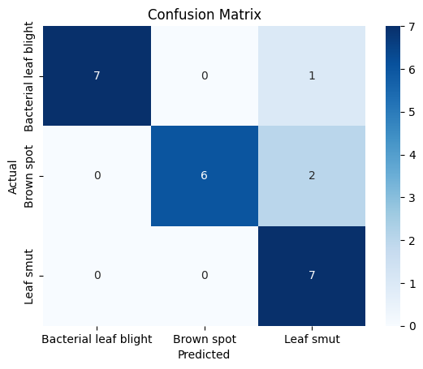
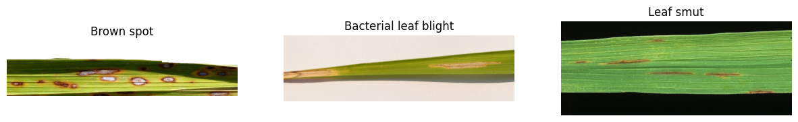
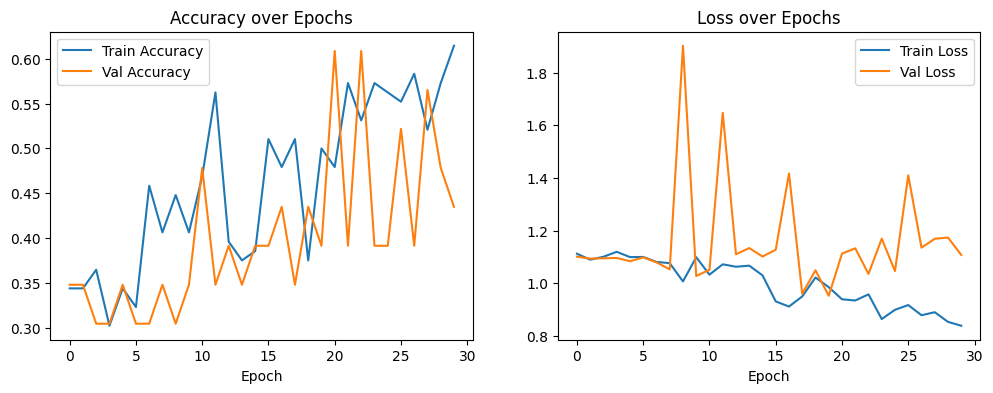

# Rice Leaf Disease Detection

Classifying photographs of rice leaves into three diseases (**bacterial leaf blight, brown spot, leaf smut**) with a CNN, using a very small dataset of about 40 images per class. The project compares a CNN trained from scratch against transfer learning with MobileNetV2, and looks at which data augmentation choices make sense for this problem.

**Best model:** MobileNetV2 transfer learning, **87.0% validation accuracy (20 of 23 images)**, against 43.5% for the from-scratch CNN.

## Results

Dataset: 119 usable images (40 / 40 / 39 per class). The split is 96 training / 23 validation images, resized to 224x224.

| Model | Parameters (trainable) | Final train acc. | Final val acc. | Best val acc. (any epoch) |
|---|---|---|---|---|
| Simple CNN from scratch | 110,147 | 61.5% | 43.5% | about 61%, very noisy |
| **MobileNetV2 (frozen base + small head)** | 82,179 | 93.75% | **87.0%** | 91.3% |

MobileNetV2 confusion matrix on the 23 validation images:

| | Pred. blight | Pred. brown spot | Pred. smut |
|---|---|---|---|
| **Actual blight** (8) | 7 | 0 | 1 |
| **Actual brown spot** (8) | 0 | 6 | 2 |
| **Actual smut** (7) | 0 | 0 | 7 |

Precision / recall: blight 1.00 / 0.88, brown spot 1.00 / 0.75, leaf smut 0.70 / 1.00. The model never misses a smut case but sometimes labels the other two classes as smut.



### How much to trust these numbers

- **The validation set is tiny.** With 23 images, one image is worth about 4.3 points of accuracy, and 20/23 has a 95% interval of roughly 68% to 95%. The gap between the two models is far larger than that and is real. Small differences would not be.
- **There is no separate test set.** The same 23 images were used to monitor training and for the final evaluation, so the "best epoch" numbers are optimistic. The headline 87.0% is the last-epoch score, not the best epoch.
- **Run-to-run variance is large** for the from-scratch CNN (an earlier run of the same architecture reached about 65% validation accuracy), because seeds were not fully fixed.

## What I did

1. **EDA:** nested-zip extraction, class balance, image size audit (only 3081x897 appears more than twice, otherwise nearly every image has a unique size), sample inspection.
2. **Augmentation:** rotation, shifts, zoom, flips and mild brightness changes on training data only. **Hue shifts were deliberately excluded** because lesion colour is part of what separates the diseases. Validation images are only rescaled.
3. **Model 1:** a 3-block CNN with `GlobalAveragePooling2D`. A first version with `Flatten` had 11.17M parameters for 96 images, so it was replaced (110k parameters).
4. **Model 2:** ImageNet-pretrained MobileNetV2 with a frozen base and a small trainable head.
5. **Evaluation fix:** an early confusion matrix showed about 22% accuracy because the generator shuffled predictions relative to labels. A separate `shuffle=False` generator fixed it.




## Limitations

- **Tiny data and one split.** Cross-validation would give a more stable estimate than a single 23-image validation set.
- **Possible shortcut learning.** The three sample images differ in background (plain light, pale pink, black), and 85 of 119 images share one size. If images from a class share a source or background, a model can score well on cues unrelated to the disease. I have not tested this, for example by cropping to the leaf or checking for near-duplicate photos split across train and validation.
- **Train/validation split is not random.** Keras `validation_split` takes the last 20% of files in each class folder, so ordering in the original dataset can matter.
- **Last-epoch model.** Validation loss was lowest at epoch 10, and later epochs show mild overfitting. Early stopping or checkpointing would likely do slightly better.
- **Aspect-ratio distortion** from resizing wide, thin leaf images to 224x224.
- **Not a diagnostic tool.** Three classes, lab-style close-ups, no healthy class and no "none of the above" option.

## Repository structure

```
notebooks/rice_leaf_disease_detection.ipynb   full analysis, outputs included
images/                                       figures used in this README
data/raw/README.md                            how to get the data
requirements.txt
```

## Reproduce

1. Get the dataset (see `data/raw/README.md`). It is not included in this repo.
2. `pip install -r requirements.txt`
3. The notebook was run on Google Colab with the data in Google Drive. To run it locally, skip the Drive-mount cell and set the extraction and `data_dir` paths to your local copy. A GPU is helpful but not required.

## Tech stack

Python, TensorFlow / Keras, MobileNetV2, scikit-learn, matplotlib, seaborn, Pillow

## License

MIT. See [LICENSE](LICENSE). The dataset has its own terms.
